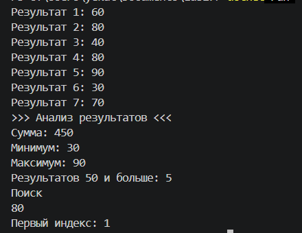

# Практическая работа № 17
Автор: Дьяконова Екатерина
Группа: ИСП-251
## Тема
Алгоритмы обработки массивов.
## Что реализовано
- сумма элементов;
- подсчёт элементов по условию;
- минимум и максимум;
- линейный поиск;
- поиск первого индекса.
## Короткие ответы
1. Почему максимум нельзя начинать с 0?
Если все числа в массиве отрицательные, программа так и вернет 0, хотя его нет в массиве.
2. Что означает "-1" после поиска индекса?
Что искомое число не найдено в массиве (так как реальные индексы начинаются с 0).
3. Чем сумма отличается от подсчёта элементов?
Сумма складывает сами числа (60+80), а подсчет считает их количество (count++).
## Результат
